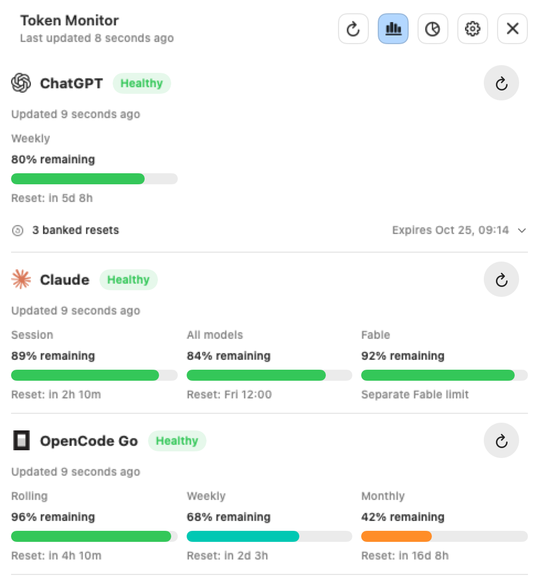
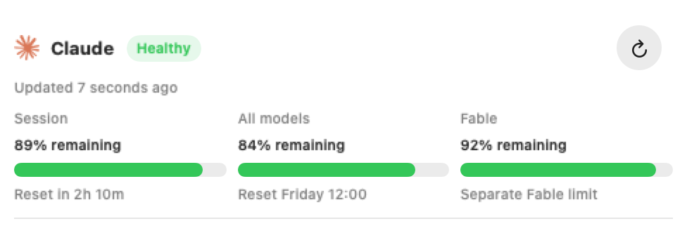
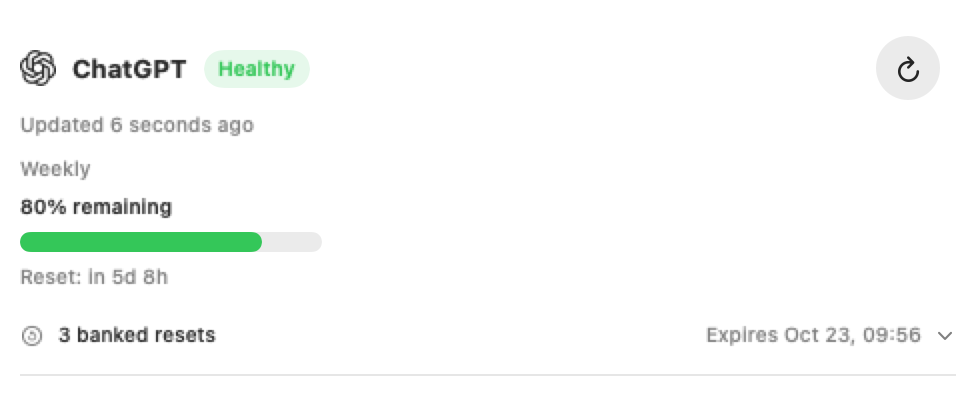
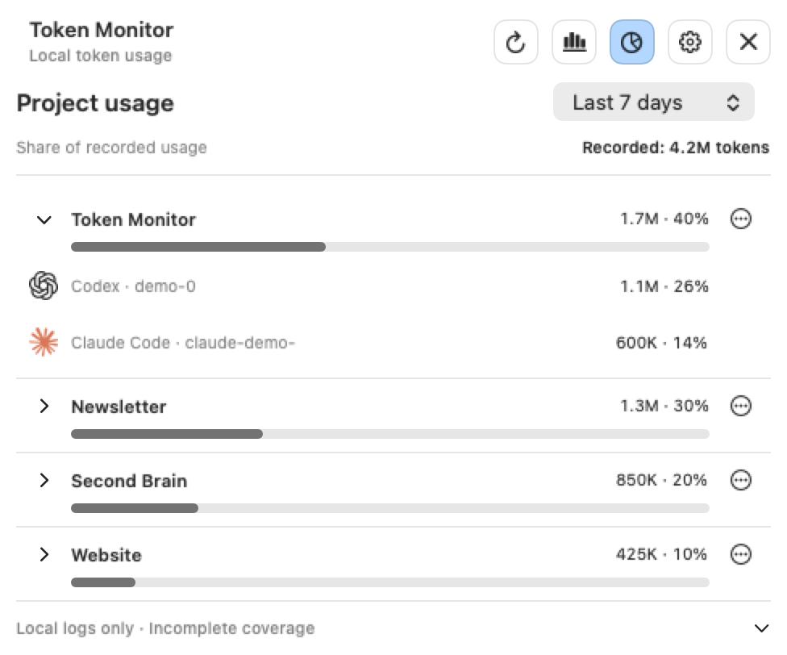
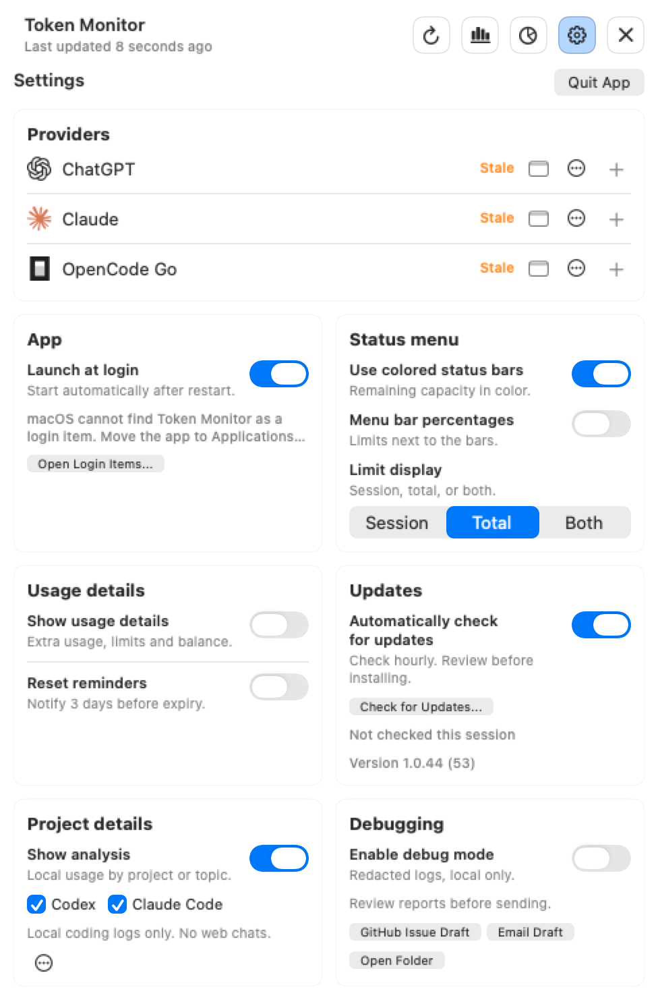
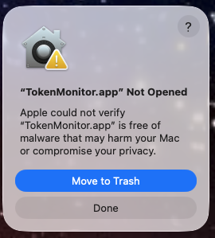
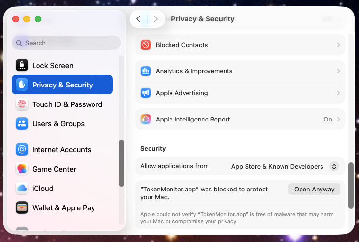
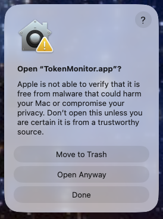
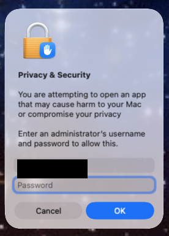

# Token Monitor

**Token Monitor** is a native macOS menu bar companion for Claude, ChatGPT/Codex, and optional OpenCode Go usage: provider-specific limits, isolated sessions, and background refresh in one lightweight desktop app.

**Token Monitor** ist ein nativer macOS-Menüleisten-Begleiter für Claude, ChatGPT/Codex und optional OpenCode Go: provider-spezifische Limits, getrennte Sessions und Hintergrund-Refresh in einer schlanken Desktop-App.

<p>
  <a href="https://github.com/MediaPublishing/token-monitor/releases/download/v1.0.44/TokenMonitor-macOS.dmg">
    
  </a>
</p>

> **Repository status / Repository-Status:** Public preview. Current preview release: `v1.0.44` (build 53).


## Screenshots

### Dashboard


Native app views with synthetic example data, not private account usage. / Native App-Ansichten mit synthetischen Beispieldaten, keine privaten Kontodaten.

Watch Claude and ChatGPT/Codex side by side from the macOS menu bar. Enable OpenCode Go in Settings when you want to track its Rolling, Weekly, and Monthly usage too.

Claude und ChatGPT/Codex bleiben direkt in der macOS-Menüleiste nebeneinander sichtbar. OpenCode Go lässt sich in den Settings optional zuschalten.

### Claude Usage


Keep Claude session, all-model and Fable limits separate, with remaining capacity and reset timing.

Session, All models und Fable bleiben getrennt, mit verbleibender Kapazität und Reset-Zeiten.

### ChatGPT + Codex Usage


Track the limits reported by ChatGPT/Codex and saved resets without digging through browser tabs.

Die von ChatGPT/Codex gemeldeten Limits und gespeicherte Resets bleiben ohne Browser-Tab-Suche sichtbar.

### Optional Local Analysis


Enable **Settings > Project details > Show analysis** to group recorded Codex and Claude Code tokens by project, or by manually assigned topic. Expand a group to its threads. Local logs can be incomplete; these totals are not the provider's remaining capacity. No cost estimates or thread-history timeline.

Mit **Settings > Project details > Show analysis** gruppierst du erfasste Codex- und Claude-Code-Tokens nach Projekt oder selbst zugewiesenem Thema. Gruppen klappen direkt zu ihren Threads auf. Lokale Protokolle können unvollständig sein; die Summen sind nicht die verbleibende Provider-Kapazität. Keine Geldschätzung und kein Thread-Verlauf.

### Settings


---

## English

### Why Token Monitor

If your work depends on Claude and ChatGPT, the limiting factor is often not the model quality but whether you still have room left in the current window. Token Monitor closes that gap from the menu bar.

- View Claude and ChatGPT/Codex in one compact popover
- Optionally add OpenCode Go after connecting the account
- Add and name multiple accounts per provider without replacing existing sign-ins; choose which one appears in the menu bar
- Keep each provider in its own persistent WebKit session
- Reconnect without clearing the provider session, or explicitly switch and disconnect accounts
- Refresh on launch, on demand, and in the background
- Preserve source-native metrics instead of inventing a combined score
- Use the menu bar icon as a quick remaining-capacity signal
- See banked ChatGPT/Codex resets and their next expiry separately from capacity
- Opt in to local expiry reminders 72 hours ahead; resets are never used automatically

### Requirements

- macOS 14.0 or newer
- Swift 6 toolchain / Command Line Tools for source builds
- Claude and/or ChatGPT account access
- Optional OpenCode Go subscription access

### Installation

Normal users should install from the GitHub Release DMG:

1. Download `TokenMonitor-macOS.dmg` from the current preview release.
2. Open the disk image.
3. Drag `TokenMonitor.app` onto the Applications shortcut.
4. Open Token Monitor and connect Claude and ChatGPT from Settings.
5. Optional: open Settings, enable **Monitor OpenCode Go**, and connect the OpenCode Go account. Its bars appear after the first successful refresh.

Current preview release download:

```text
https://github.com/MediaPublishing/token-monitor/releases/download/v1.0.44/TokenMonitor-macOS.dmg
```

#### Gatekeeper: If macOS says "TokenMonitor.app" Not Opened

Preview builds may show Apple's "could not verify" warning until the app is Developer ID signed and notarized. Only continue if you downloaded the DMG from this repository and trust that build.

1. Click **Done**, not **Move to Trash**.
2. Open **System Settings > Privacy & Security**.
3. Scroll to **Security**.
4. Find the message that `TokenMonitor.app` was blocked and click **Open Anyway**.
5. Confirm with your Mac password or Touch ID, then click **Open**.

Visual walkthrough:

| Step 1 | Step 2 |
| --- | --- |
| Click **Done**, not **Move to Trash**. | Open **System Settings > Privacy & Security** and click **Open Anyway**. |
|  |  |

| Step 3 | Step 4 |
| --- | --- |
| Confirm by clicking **Open Anyway**. | Enter your Mac password or use Touch ID, then click **OK**. |
|  |  |

macOS stores this exception for Token Monitor, so future launches should open normally. If **Open Anyway** is not visible, try opening `TokenMonitor.app` once more, then return to **Privacy & Security**. Apple's official guide is here: <https://support.apple.com/guide/mac-help/open-a-mac-app-from-an-unknown-developer-mh40616/mac>

#### Launch at login

Token Monitor tries to register itself as a login item when **Launch at login** is enabled in Settings. macOS requires apps that use Apple's ServiceManagement login-item API to be code signed, so ad-hoc preview builds may not appear under **System Settings > General > Login Items**. Move `TokenMonitor.app` to **Applications**, open it once, then use **Settings > Launch at login** inside Token Monitor. If macOS still requires approval, open **Login Items** from Token Monitor Settings and allow Token Monitor there.

#### Updates

Automatic update checks are off by default from version `1.0.22` through public version `1.0.42`. Version `1.0.43` enables automatic checks by default, while preserving an existing opt-out. From version `1.0.41`, enabling **Automatically check for updates** checks immediately, then hourly while the app is running. An **Update** indicator in the menu bar and a **Review Update** button in the dashboard make available updates visible without hidden background windows. Review and confirm installation in Sparkle; enabling checks does not enable silent installation. **Check for Updates...** remains available in Settings. The debug report includes update timing, preferences, results, and error codes. Existing sign-ins are preserved.

#### Optional OpenCode Go

OpenCode Go monitoring is off by default. In Settings, enable **Monitor OpenCode Go**, click **Connect OpenCode Go**, and sign in on the OpenCode page. Token Monitor follows the authenticated workspace page and reads **5-hour Usage**, **Weekly Usage**, and **Monthly Usage**. The OpenCode Go section and its menu bar indicator appear only after a successful connection and refresh.

Version 1.0.36 reuses the connected workspace instead of checking the public Go marketing page. Both the original workspace and the new OpenCode Console are supported. Accounts migrated by OpenCode may need one sign-in to the new Console; app updates do not clear provider sessions.

Version 1.0.38 reads Claude's updated **This week** and **Fable this week** usage labels while keeping their percentages and reset times associated with the correct limit. Version 1.0.39 also supports ChatGPT's unified Usage dashboard, including **% left**, relative reset times, and an inline credit balance.

#### Multiple accounts

In **Settings > Providers**, click **+** next to Claude, ChatGPT, or OpenCode Go to add another account. Give it a name with **More > Rename**. Each additional account keeps its own persistent sign-in and appears separately in the dashboard. The original account and its existing sign-in stay in place. Choose **Show in menu bar** on the account whose capacity the provider's menu-bar indicator should show. Disconnecting or removing an additional account clears only that account's login data. The original provider accounts remain available for compatibility with previous versions.

**Version 1.0.44 (53):** Selected accounts share one compact menu-bar item: two or three stacked, four in a 2-by-2 grid, and five or six in two columns of up to three. Additional selected accounts appear as **+N**; open the normal menu to see all accounts. Use **Add to menu bar**, **Hide from menu bar**, and **Show first for Claude** (or the other provider) in each account's Settings menu. Order and existing selections are preserved, with immediate cached updates and no reauthentication. Session/Total/**Both** still uses one track per account; optional percentages remain available. Native 1x/2x drawing keeps the small bars sharp. Reset subtitles use concise **Reset:** labels with short weekdays, dates and 24-hour times; hover to read the unchanged original provider text.

**Version 1.0.43 (52):** Capacity, analysis, and Settings resize to their content, with scrolling only when the active display cannot fit the content. The existing native toolbar gains an optional analysis icon. Genuine, bundled vector provider logos accompany visible account names and render natively at the display's scale. Toolbar focus uses the full button outline only during keyboard navigation, not after opening the popover or clicking with the mouse. Project details expand directly to threads; token counts and shares appear together, with neutral usage bars. Settings use aligned rows, and reset reminders report notification permission problems and target the correct ChatGPT account. Switching the menu-bar account updates its cached capacity immediately, without a manual refresh. **Show alongside in menu bar** adds another account in a separate column; **Hide from menu bar** removes it from the indicator without disconnecting it. Up to four accounts per provider can be shown, with names and column order in the tooltip. **Move to first menu bar column** changes their order.

ChatGPT Connect now starts on the home page and waits for a positive sign-in signal before opening usage. Blank or canceled loads never reload the login form. If automatic detection is unavailable, **Read usage** opens the usage page after you finish signing in. A connection is completed only after real usage metrics are parsed. No cookies are cleared by this recovery flow.

For local builds, use `bash scripts/install-local-app.sh` after building, or `bash scripts/install-local-app.sh --check` to validate without installing. The previous app is kept outside Trash under `~/AI/backups/token-monitor/`, preventing SmartDelete-style cleaners from offering to remove the app's sign-in data during replacement. The installer does not read or copy account, cookie or session data.

#### Banked resets

The ChatGPT section includes a compact reset count and the next expiry in local 24-hour time. Click it for individual reset types and dates. These saved resets are separate from remaining capacity; Token Monitor never redeems them. Missing or loading data is not treated as zero, and older reset data is marked **Last seen** until confirmed by a fresh reading.

An explicit **Available 0** clears consumed resets and their pending expiry reminders. Reset history is excluded from the available count.
Version 1.0.37 also reads the current **Available 1** tab label when its number is on the same line and the History tab appears before the available reset card.

Enable **Settings > Usage details > Reset reminders** and allow macOS notifications. Reminders are scheduled locally for 72 hours before each known expiry, or immediately when first detected later. Consumed resets and disconnected accounts have their reminders removed after a successful refresh or disconnect. A scheduled reminder can appear even when Token Monitor is closed. If macOS denies permission, enable Token Monitor in **System Settings > Notifications**, then turn on **Reset reminders** again. Unknown expiry dates cannot trigger a reliable reminder.

### Build From Source

```bash
git clone https://github.com/MediaPublishing/token-monitor.git
cd token-monitor
swift build
swift run TokenMonitorApp
```

Run the app directly through the project script:

```bash
./scripts/run-app.sh
```

Create a local app bundle:

```bash
./scripts/build-app.sh
open dist/TokenMonitor.app
```

Create only the local DMG installer:

```bash
./scripts/package-dmg.sh
```

### Privacy

Token Monitor stores only the latest successful usage snapshots locally at `~/Library/Application Support/TokenMonitor/snapshots.json`. Each provider uses its own persistent WebKit session, so Claude and ChatGPT login state stay isolated from each other and from your normal browser cookies.

Debug mode is off by default. When enabled in Settings, Token Monitor stores redacted refresh diagnostics locally in `~/Library/Application Support/TokenMonitor/Debug/`. Reports open only as drafts for GitHub Issues or email, so you can review them before submitting. GitHub Issues are public.

---

## Deutsch

### Warum Token Monitor

Wenn deine Arbeit von Claude und ChatGPT abhängt, ist oft nicht die Modellqualität der Engpass, sondern ob im aktuellen Fenster noch Kapazität übrig ist. Token Monitor schließt genau diese Lücke in der Menüleiste.

- Claude und ChatGPT/Codex in einem kompakten Popover sehen
- OpenCode Go bei Bedarf optional hinzufügen
- Jeden Provider in einer eigenen persistenten WebKit-Session halten
- Provider neu verbinden, ohne die Sitzung zu löschen, oder Accounts ausdrücklich wechseln und trennen
- Beim Start, manuell und im Hintergrund aktualisieren
- Quellnahe Metriken behalten statt einen künstlichen Gesamtscore zu bauen
- Das Menüleisten-Icon als schnelles Restkapazitäts-Signal nutzen
- Gespeicherte ChatGPT-/Codex-Resets mit Ablaufdatum getrennt von der Restkapazität sehen
- Lokale Erinnerungen 72 Stunden vor Ablauf aktivieren; Resets werden nie automatisch eingelöst

### Voraussetzungen

- macOS 14.0 oder neuer
- Swift 6 Toolchain / Command Line Tools für Source-Builds
- Claude- und/oder ChatGPT-Account-Zugriff
- Optional: OpenCode-Go-Abonnement

### Installation

Normale Nutzer sollten über das GitHub-Release-DMG installieren:

1. `TokenMonitor-macOS.dmg` aus dem aktuellen Preview-Release herunterladen.
2. Disk Image öffnen.
3. `TokenMonitor.app` auf die Applications-Verknüpfung ziehen.
4. Token Monitor öffnen und Claude sowie ChatGPT in den Settings verbinden.
5. Optional: In den Settings **Monitor OpenCode Go** aktivieren und OpenCode Go verbinden. Die Balken erscheinen nach dem ersten erfolgreichen Refresh.

Aktueller Preview-Release-Download:

```text
https://github.com/MediaPublishing/token-monitor/releases/download/v1.0.44/TokenMonitor-macOS.dmg
```

#### Gatekeeper: Wenn macOS "TokenMonitor.app" nicht öffnet

Preview-Builds können Apples "konnte nicht überprüfen"-Warnung zeigen, bis die App mit Developer ID signiert und notarized ist. Fahre nur fort, wenn du das DMG aus diesem Repository geladen hast und diesem Build vertraust.

1. **Fertig** klicken, nicht **In den Papierkorb legen**.
2. **Systemeinstellungen > Datenschutz & Sicherheit** öffnen.
3. Zu **Sicherheit** scrollen.
4. Die Meldung suchen, dass `TokenMonitor.app` blockiert wurde, und **Dennoch öffnen** klicken.
5. Mit Mac-Passwort oder Touch ID bestätigen, danach **Öffnen** klicken.

Visuelle Schritt-für-Schritt-Anleitung:

| Schritt 1 | Schritt 2 |
| --- | --- |
| **Fertig** klicken, nicht **In den Papierkorb legen**. | **Systemeinstellungen > Datenschutz & Sicherheit** öffnen und **Dennoch öffnen** klicken. |
|  |  |

| Schritt 3 | Schritt 4 |
| --- | --- |
| Mit **Open Anyway** bestätigen. | Mac-Passwort eingeben oder Touch ID nutzen, danach **OK** klicken. |
|  |  |

macOS speichert diese Ausnahme für Token Monitor, danach sollte die App normal starten. Wenn **Dennoch öffnen** nicht sichtbar ist, öffne `TokenMonitor.app` noch einmal und gehe danach wieder zu **Datenschutz & Sicherheit**. Apples offizielle Anleitung: <https://support.apple.com/guide/mac-help/open-a-mac-app-from-an-unknown-developer-mh40616/mac>

#### Beim Login starten

Token Monitor versucht, sich als Login Item zu registrieren, wenn **Launch at login** in den Settings aktiv ist. macOS verlangt für Apps mit Apples ServiceManagement-Login-Item-API eine Code-Signatur, deshalb erscheinen ad-hoc signierte Preview-Builds möglicherweise nicht unter **Systemeinstellungen > Allgemein > Anmeldeobjekte**. Verschiebe `TokenMonitor.app` nach **Applications**, öffne die App einmal und nutze danach **Settings > Launch at login** in Token Monitor. Wenn macOS weiterhin eine Freigabe verlangt, öffne **Anmeldeobjekte** aus den Token-Monitor-Settings und erlaube Token Monitor dort.

#### Updates

Automatische Update-Prüfungen sind ab Version `1.0.22` standardmäßig aus, bis einschließlich der öffentlichen Version `1.0.42`. Version `1.0.43` aktiviert automatische Prüfungen standardmäßig, respektiert aber eine bereits gespeicherte Abschaltung. Ab Version `1.0.41` prüft **Automatically check for updates** beim Einschalten sofort und danach stündlich, solange die App läuft. Ein **Update**-Hinweis in der Menüleiste und **Review Update** im Dashboard machen verfügbare Updates sichtbar, statt ein Fenster im Hintergrund zu verstecken. Die Installation wird in Sparkle bestätigt; der Schalter aktiviert keine stille Installation. **Check for Updates...** bleibt in den Settings verfügbar. Der Debug-Bericht enthält Prüfzeiten, Update-Einstellungen, Ergebnisse und Fehlercodes. Bestehende Anmeldungen bleiben erhalten.

#### Optionales OpenCode Go

Die OpenCode-Go-Überwachung ist standardmäßig deaktiviert. Aktiviere in den Settings **Monitor OpenCode Go**, klicke auf **Connect OpenCode Go** und melde dich auf der OpenCode-Seite an. Token Monitor folgt der authentifizierten Workspace-Seite und liest **5-hour Usage**, **Weekly Usage** und **Monthly Usage**. Der OpenCode-Go-Bereich und sein Menüleisten-Balken erscheinen erst nach erfolgreicher Verbindung und Aktualisierung.

Version 1.0.36 verwendet den verbundenen Workspace statt der öffentlichen Go-Werbeseite. Sowohl die bisherigen Workspaces als auch die neue OpenCode Console werden unterstützt. Von OpenCode umgezogene Accounts können eine einmalige Anmeldung in der neuen Console benötigen; App-Updates löschen keine Provider-Sitzungen.

Version 1.0.38 liest Claudes neue Nutzungslabels **This week** und **Fable this week** und ordnet Prozentwerte und Reset-Zeiten wieder dem richtigen Limit zu. Version 1.0.39 unterstützt zusätzlich ChatGPTs vereinheitlichtes Usage-Dashboard mit **% left**, relativen Reset-Zeiten und dem Guthaben direkt in der Überschrift.

#### Mehrere Accounts

Unter **Settings > Providers** kannst du mit **+** für Claude, ChatGPT oder OpenCode Go weitere Accounts hinzufügen und über **More > Rename** benennen. Jeder zusätzliche Account bekommt eine eigene dauerhafte Anmeldung und erscheint separat im Dashboard. Der bisherige Account samt Login bleibt bestehen. Mit **Show in menu bar** bestimmst du, welcher Account eines Providers die Balken in der Menüleiste liefert. Das Trennen oder Entfernen eines zusätzlichen Accounts löscht nur dessen Login-Daten.

**Version 1.0.44 (53):** Ausgewählte Konten teilen sich ein kompaktes Menüleisten-Symbol: zwei oder drei untereinander, vier als 2×2 und fünf oder sechs in zwei Spalten mit höchstens drei Zeilen. Weitere ausgewählte Konten erscheinen als **+N**; das normale Menü zeigt alle Konten. Im Kontomenü der Settings heißen die Aktionen **Add to menu bar**, **Hide from menu bar** und **Show first for Claude** (beziehungsweise den anderen Anbieter). Reihenfolge und bestehende Auswahl bleiben erhalten, Änderungen zeigen sofort die gecachten Werte ohne Neuanmeldung. Session/Total/**Both** verwendet weiterhin einen gemeinsamen Balken je Konto, Prozentwerte bleiben optional. Native 1x-/2x-Darstellung hält kleine Balken scharf. Kurze **Reset:**-Texte mit abgekürzten Wochentagen, Datum und 24-Stunden-Zeit ersetzen lange Anbieterformulierungen; beim Hover bleibt der unveränderte Originaltext lesbar.

**Version 1.0.43 (52):** Kapazität, Analyse und Settings passen ihre Höhe an den Inhalt an. Nur wenn der Platz auf dem aktiven Bildschirm nicht reicht, wird gescrollt. Die native Kopfzeile erhält ein optionales Analyse-Icon. Echte, lokal gebündelte Vektorlogos stehen neben den lesbaren Kontonamen und werden nativ in der Bildschirmauflösung gezeichnet. Der Toolbar-Fokus verwendet den ganzen Button-Rahmen nur bei Tastaturbedienung, nicht beim Öffnen oder nach Mausklicks. Projekte klappen direkt zu ihren Threads auf; Tokenzahl und Anteil stehen zusammen, die Analysebalken bleiben neutral. Die Settings sind in abgestimmten Zeilen angeordnet. Reset-Erinnerungen zeigen Berechtigungsprobleme an und öffnen das richtige ChatGPT-Konto. Beim Kontowechsel zeigt die Menüleiste sofort die zuletzt erfasste Kapazität des gewählten Kontos, ohne manuellen Refresh. Mit **Show alongside in menu bar** erscheint ein weiteres Konto in einer eigenen Spalte daneben. **Hide from menu bar** blendet es nur aus, ohne es zu trennen. Bis zu vier Konten je Anbieter sind möglich; Namen und Spaltenreihenfolge stehen im Tooltip. **Move to first menu bar column** ändert die Reihenfolge.

ChatGPT Connect startet auf der Startseite und öffnet die Nutzung erst nach einem positiven Anmeldenachweis. Leere oder abgebrochene Ladevorgänge laden das Login-Formular nicht neu. Falls die automatische Erkennung ausfällt, öffnet **Read usage** nach abgeschlossener Anmeldung die Nutzungsseite. Erst erfolgreich gelesene Nutzungswerte schließen die Verbindung ab. Dabei werden keine Cookies gelöscht.

#### Banked Resets

Unter ChatGPT stehen die Anzahl gespeicherter Resets und der nächste Ablauf in lokaler 24-Stunden-Zeit. Ein Klick öffnet die einzelnen Reset-Typen und Termine. Diese Resets bleiben von der Restkapazität getrennt und werden niemals automatisch eingelöst. Fehlende oder noch ladende Daten gelten nicht als null. Ältere Werte sind bis zur erneuten Bestätigung als **Last seen** gekennzeichnet.

Ein bestätigtes **Available 0** entfernt verbrauchte Resets und ihre geplanten Ablauf-Erinnerungen. Die Reset-Historie zählt nicht zum verfügbaren Bestand.
Version 1.0.37 erkennt auch **Available 1** auf einer Zeile und liest die verfügbare Reset-Karte hinter dem History-Reiter.

Aktiviere **Settings > Usage details > Reset reminders** und erlaube Mitteilungen in macOS. Die Erinnerung wird lokal für 72 Stunden vor dem bekannten Ablauf vorgemerkt; bei späterer Erkennung sofort. Nach erfolgreicher Aktualisierung werden Erinnerungen für verbrauchte Resets entfernt, beim Trennen des Accounts ebenfalls. Bereits geplante Mitteilungen können auch bei geschlossener App erscheinen. Bei verweigerter Freigabe: Token Monitor unter **Systemeinstellungen > Mitteilungen** erlauben und **Reset reminders** erneut aktivieren. Ohne lesbares Ablaufdatum ist keine verlässliche Erinnerung möglich.

### Aus dem Source Code bauen

```bash
git clone https://github.com/MediaPublishing/token-monitor.git
cd token-monitor
swift build
swift run TokenMonitorApp
```

App direkt über das Projektskript starten:

```bash
./scripts/run-app.sh
```

Lokales App-Bundle erstellen:

```bash
./scripts/build-app.sh
open dist/TokenMonitor.app
```

Nur den lokalen DMG-Installer erstellen:

```bash
./scripts/package-dmg.sh
```

### Datenschutz

Token Monitor speichert nur die letzten erfolgreichen Usage-Snapshots lokal unter `~/Library/Application Support/TokenMonitor/snapshots.json`. Jeder Provider nutzt eine eigene persistente WebKit-Session, damit Claude- und ChatGPT-Login getrennt bleiben und keine normalen Browser-Cookies verwendet werden.

Der Debug-Modus ist standardmäßig aus. Wenn er in den Einstellungen aktiviert wird, speichert Token Monitor redigierte Refresh-Diagnosen lokal unter `~/Library/Application Support/TokenMonitor/Debug/`. Reports werden nur als GitHub-Issue- oder E-Mail-Entwurf geöffnet, damit du sie vor dem Absenden prüfen kannst. GitHub Issues sind öffentlich.

---

## Project Structure

```text
token-monitor/
├── Package.swift
├── Sources/TokenMonitorApp/
├── Sources/TokenMonitorCore/
├── Tests/TokenMonitorCoreTests/
├── assets/
├── docs/
├── landing/
└── scripts/
```

## Documentation

- [Landing page](landing/index.html)
- [Public landing page](https://token-monitor-landing.pages.dev/)
- [Current screenshot](docs/token-monitor-screenshot.png)
- [Support](SUPPORT.md)
- [Security policy](SECURITY.md)
- [Product backlog](docs/product-backlog.md)
- [Apple access handoff](docs/apple-access-handoff.md)
- [Apple distribution readiness](docs/apple-distribution-readiness.md)
- [Apple credential runbook](docs/apple-credential-runbook.md)
- [Mac App Store feasibility audit](docs/mac-app-store-feasibility.md)
- [App Store submission packet](docs/app-store-submission-packet.md)
- [App Store review risk register](docs/app-store-review-risk-register.md)
- [App Store Connect identity checklist](docs/app-store-connect-identity.md)
- [App Store privacy labels](docs/app-store-privacy-labels.md)
- [App Store screenshot checklist](docs/app-store-screenshot-checklist.md)
- [Release recovery runbook](docs/release-recovery-runbook.md)
- [Issue triage runbook](docs/issue-triage-runbook.md)
- [Marketing launch kit](docs/marketing-launch-kit.md)
- [Publication legal checklist](docs/publication-legal-checklist.md)
- [Privacy summary](docs/privacy.md)

## License

License information is not published in this repository yet.
